## Featured projects

[Banking Backend](https://github.com/edamame69/banking-app) · [MyCloud](https://github.com/edamame69/MyCloud) · [Smart Room IoT](https://github.com/edamame69/smartroom-iot) · [All repositories](https://github.com/edamame69?tab=repositories)

## GitHub activity

How these cards are built

A Python script renders the SVGs from my [public GitHub contribution calendar](https://github.com/users/edamame69/contributions). A GitHub Actions workflow refreshes them daily. The cards respect your system's reduced-motion preference.

Run `python3 scripts/render_readme_cards.py` to refresh the cards locally or `STATIC=1 python3 scripts/render_readme_cards.py --output-dir /tmp/profile-preview` to render the final frame for a preview.

Inspired by [Avi Vashishta's animated GitHub profile README](https://www.avivashishta.com/blog/github-profile-readme-animated-svg-cards).

