## Featured projects

[Banking Backend](https://github.com/edamame69/banking-app) · [MyCloud](https://github.com/edamame69/MyCloud) · [EPL Zone](https://github.com/edamame69/EPL_zone) · [All repositories](https://github.com/edamame69?tab=repositories)

## GitHub activity

